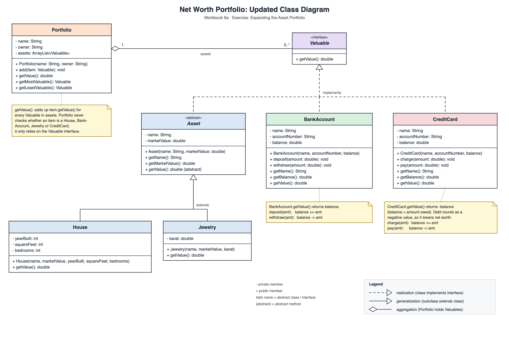

# Expanding the Asset Portfolio — UML Design

Workbook 6a, Exercise: Expanding the Asset Portfolio (pages 19–20).

| File | What it is |
| --- | --- |
| `asset-portfolio-uml.pdf` | Exported class diagram (submission) |
| `asset-portfolio-uml.png` | Same diagram as a high-resolution image |
| `asset-portfolio-uml.svg` | Vector source of the diagram |
| `src/build_diagram.py` | Script that draws the diagram (`python3 src/build_diagram.py`) |

## Design summary

- **`Valuable` (interface)** declares one method: `getValue(): double`. It has no banking methods.
- **`Asset` (abstract)** implements `Valuable`. Because the base class implements it, every fixed asset
  (`House`, `Jewelry`) is automatically `Valuable` without changing those subclasses.
- **`BankAccount`** implements `Valuable` directly (it does **not** extend `Asset`).
  It adds `deposit` and `withdraw`; `getValue()` returns the balance.
- **`CreditCard`** implements `Valuable` directly (it does **not** extend `Asset`).
  It adds `charge` and `pay`; `balance` is the amount owed and `getValue()` returns `-balance`.
- **`Portfolio`** now stores `ArrayList<Valuable>` instead of `ArrayList<Asset>`, and `add(Valuable)`.
  `getValue()` adds up `item.getValue()` for every item.

## Answers to the discussion questions

**Step 1: Review the existing design**
- Fixed assets: the abstract `Asset` base class and its subclasses `House` and `Jewelry`.
- `Portfolio` originally kept its contents in an `ArrayList<Asset>`.
- It found the total by looping over the list and summing each asset's `getValue()`.

**Step 3: The `Valuable` interface**
1. *Which classes are `Valuable`?* `Asset` (and so `House` and `Jewelry`), `BankAccount`, and `CreditCard`.
2. *Where is it implemented?* On the abstract `Asset` class. The fixed-asset subclasses inherit it, so they keep
   working unchanged. `BankAccount` and `CreditCard` implement it on their own, outside the `Asset` hierarchy.
3. *How does debt count?* `CreditCard.getValue()` returns the balance owed as a **negative** number.
   When the portfolio sums all values, the debt is subtracted automatically, which gives
   **net worth = what you own − what you owe**. Example: house $300,000 + bank $5,000 + card owing $2,000
   → $300,000 + $5,000 + (−$2,000) = **$303,000**.

**Step 4: The `Portfolio` class**
- *Can `ArrayList<Asset>` hold all three kinds?* No. `BankAccount` and `CreditCard` are not `Asset`s.
- *What common type works?* The `Valuable` interface: `ArrayList<Valuable>`.
- *How does it get each item's contribution?* It calls `getValue()` through the interface (polymorphism).
  It never needs to know whether the item is a house, a bank account, or a credit card.

## Design choices to be ready to explain
- **Interface instead of inheritance:** a bank account is not a kind of fixed asset, so it should not extend `Asset`.
  The interface shares only the one capability they have in common.
- **Each class owns its behavior:** account methods (`deposit`, `withdraw`, `charge`, `pay`) live only in the
  account classes. Fixed assets and the interface stay free of them.
- **Sign convention for debt:** `CreditCard` stores the amount owed as a positive `balance` (easy for `charge`/`pay`)
  and flips the sign only in `getValue()`.
- **Most/least valuable:** `getMostValuable()` and `getLeastValuable()` return a `Valuable`, so a credit card with a
  large balance will naturally be the "least valuable" item.
- *Original fields:* the attributes shown for `Asset`, `House` and `Jewelry` follow the page-19 diagram as we
  understood it. Adjust names to match your copy of the workbook if they differ.
